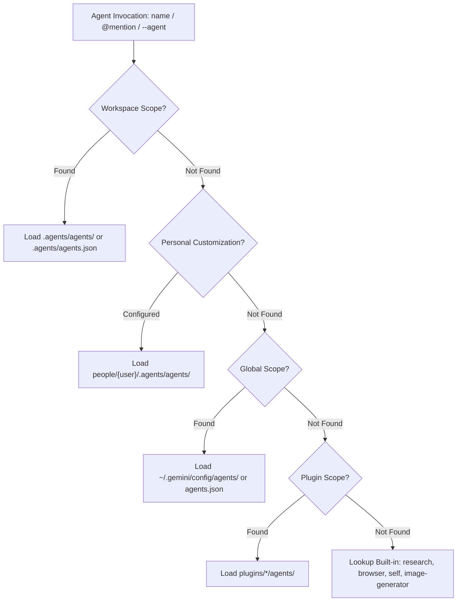
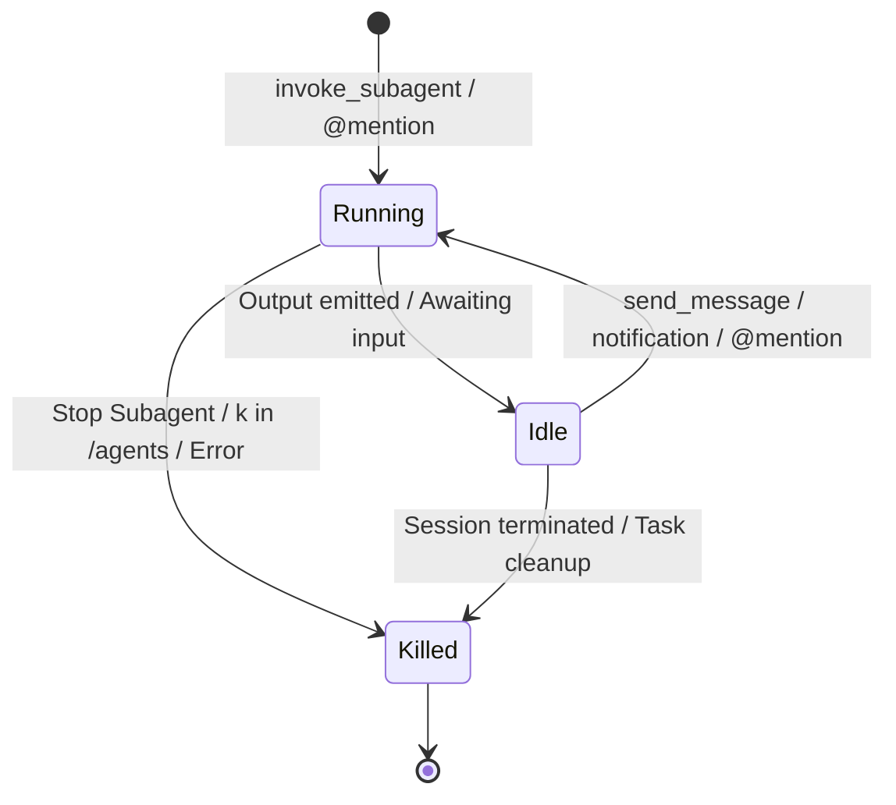
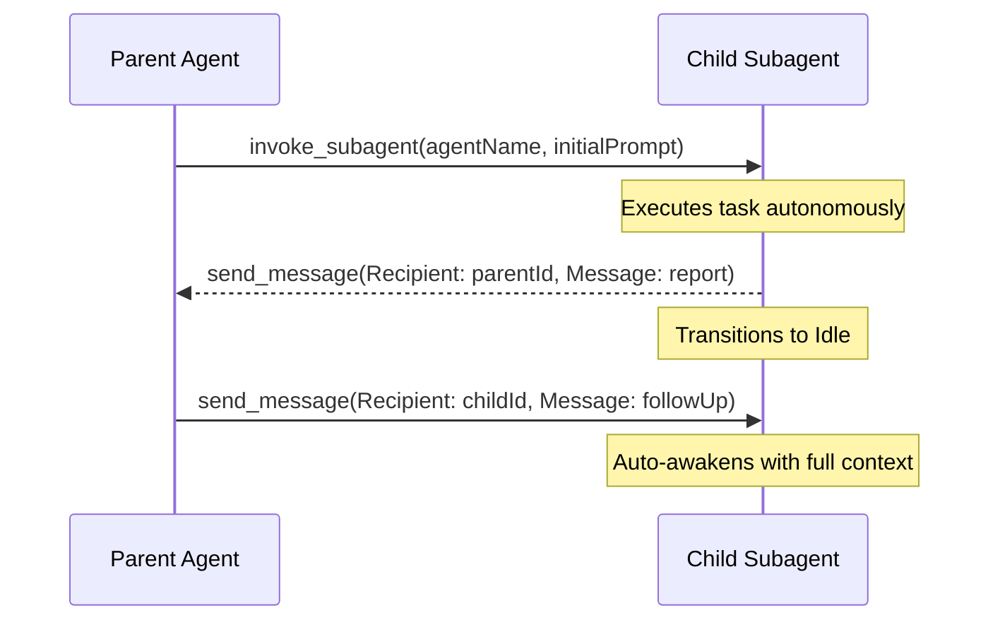
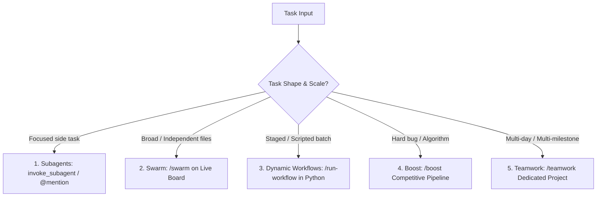

# Google Antigravity Sub-Agents: Complete Architecture, Configuration & Best Practices Guide

Sub-agents in Google Antigravity allow complex engineering tasks to be delegated to specialized, modular AI agents with isolated contexts, explicit tool permissions, and customized system instructions.

This guide provides the complete specification for sub-agent discovery, package structures, frontmatter configuration, lifecycle management, communication protocols, permission inheritance, and prompt design.

---

## 1. Agent Discovery Architecture & Package Formats

Antigravity resolves agent definitions from three hierarchical tiers. When an agent is invoked by name, Antigravity searches these tiers in order of precedence: **Workspace > Global > Plugin**.



### Discovery Paths & Manifests

| Scope | Discovery Path | Description |
|---|---|---|
| **Workspace** | `.agents/agents/<name>.md`<br>`.agents/agents/<name>/agent.md` | Project-specific agents committed to repository version control. Overrides global and plugin agents with identical names. |
| **Workspace Manifest** | `.agents/agents.json` | Discovery manifest declaring agents stored outside standard folders or nested deeper than 1 level. |
| **Personal Customization** | `people/{user}/.agents/agents/` | Configured via `.gemini/config.json` (`personal_customization_dir: "people/{user}"`) at repository root. `{user}` expands to `USER` / `USERNAME`. Takes precedence over project-level `.agents/`. |
| **Global / Personal** | `~/.gemini/config/agents/<name>.md`<br>`~/.gemini/config/agents/<name>/agent.md` | User-wide agents available across all projects. Manifest: `~/.gemini/config/agents.json` or `~/.gemini/agents.json`. On Windows: `%USERPROFILE%\.gemini\config\agents\`. |
| **Plugin** | `plugins/<plugin_name>/agents/<name>.md`<br>`plugins/<plugin_name>/agents/<name>/agent.md` | Bundled agents distributed with installed Antigravity plugins. |

#### Discovery Manifest Schema (`agents.json`)

When agents reside in custom directories or are nested deeper than the standard 1-level scan, list them in an `agents.json` manifest:

```json
{
  "entries": [
    {
      "path": "custom/agents",
      "exclude": ["deprecated-agent"]
    },
    {
      "path": ".agents/specialized",
      "include_only": ["infra-auditor"]
    }
  ],
  "inherits": [
    {
      "path": "/shared/team-configs/.agents/agents.json"
    }
  ]
}
```

- **`entries`**: Array of objects specifying folders to scan (`path`), optional `include_only`, or `exclude`.
- **`inherits`**: Inherit another shared `agents.json` manifest from an absolute or relative path.
- **`exclude`**: Custom agent identifiers to hide across all discovery locations.

### Invocation Channels

Custom subagents can be initiated through three distinct channels:
1. **Tool Invocation (`invoke_subagent`)**: Programmatic delegation by parent agents and orchestrators.
2. **Direct Chat Mentions (`@<subagent-name>`)**: Start any chat prompt with `@` followed by the agent or subagent name (e.g. `@research:API-Key-Header-Researcher Also check the unit tests.` or `@code-auditor Audit src/routes/`). Sends the message directly to that agent's conversation thread.
3. **Shell CLI Commands**:
   - `agy agents`: Lists all available agents across built-in, workspace, personal, and plugin scopes.
   - `agy --agent <name>`: Launches an interactive or headless session using the specified custom agent as the primary session controller (e.g. `agy --agent code-auditor` or `agy -p "Review src/" --agent code-auditor`).

### Supported Package Formats

Antigravity supports two static package formats:

1. **Single-File Format (`<name>.md`)**
   - The entire agent definition—YAML frontmatter and Markdown system prompt—is contained within a single `.md` file.
   - Best for lightweight, self-contained agents.
   - Example: `.agents/agents/explore.md`

2. **Directory Package Format (`<name>/agent.md`)**
   - The entrypoint definition resides in `agent.md` within a folder named after the agent.
   - Best for complex sub-agents requiring auxiliary documentation, reference schemas, local templates, or sub-assets.
   - Example: `.agents/agents/reviewer/agent.md`

### Dynamic Sub-Agent Definition (`define_subagent`)

In addition to static Markdown files, agents can be registered programmatically at runtime using the `define_subagent` tool. This is useful for dynamic multi-agent task planning or ephemeral workers:

```json
{
  "name": "ephemeral-analyst",
  "description": "Analyzes memory dumps and benchmark profiles on demand.",
  "system_prompt": "<identity>You are a performance profiling specialist...</identity>",
  "enable_write_tools": false,
  "enable_mcp_tools": true,
  "enable_subagent_tools": false
}
```

---

## 2. Complete YAML Frontmatter Specification

Static agent definitions begin with a YAML frontmatter block enclosed between triple dashes (`---`). The table below outlines official frontmatter fields defined by Antigravity:

| Field | Type | Default | Description |
|---|---|---|---|
| `name` | `string` | **Required** | Unique identifier used when invoking via `invoke_subagent`, chat `@mention`, or CLI `--agent`. |
| `description` | `string` | **Required** | Detailed description of the agent's role, triggers, and capabilities. Used by orchestrators for autonomous routing. |
| `tools` | `string[]` | `[]` | Explicit whitelist of permitted tools (e.g. `read_file`, `write_file`, `edit_file`, `run_command`). **If omitted, no file system or execution tools are available!** (Note: `send_message` is always automatically granted). |
| `mainAgent` | `boolean` | `true` | If `true`, allows selection as the primary agent in chat interfaces and CLI (`--agent <name>`). Set to `false` for dedicated worker subagents. |
| `subagent` | `boolean` | `true` | If `true`, allows invocation via the `invoke_subagent` tool. Set to `false` for main-only controllers. |
| `model` | `string` | `inherit` | Model tier used when invoked: `inherit`, `flash`, `flash_lite`, `pro`, or specific model IDs. |
| `commandExecutionPolicy` | `string` | `sandbox` | Auto-execution policy for shell commands: `off`, `auto`, `eager`, `sandbox`. |
| `inheritMcp` | `boolean` | `true` | When `true`, inherits Model Context Protocol (MCP) servers and tools registered in the parent session. *(Standard YAML frontmatter property; distinct from `enable_mcp_tools` which applies to `define_subagent`)*. |
| `inheritCustomizations` | `boolean` | `true` | When `true`, inherits project-level rules, system instructions, and workspace customizations from the active project. |
| `mcpServers` | `object[]` | `[]` | Custom Model Context Protocol (MCP) servers configured specifically for this subagent. |
| `skills` / `plugins` | `string[]` | `[]` | Skill paths (e.g. `skills/my-helper-skill`, `skills/ast-grep`) or plugin dependencies pre-loaded into context. |

> [!NOTE]
> **Runtime Options & Frontmatter Boundary**:
> - `workspace`: Workspace isolation mode (`inherit`, `branch`, or `share`) is a runtime parameter passed to the `invoke_subagent` tool call (see [Workspace Isolation Modes](#workspace-isolation-modes-workspace)) and **MUST NOT** be placed inside the YAML frontmatter of a static `.md` agent definition.
> - `inheritMcp`: Use `inheritMcp: true` in static YAML frontmatter. `enable_mcp_tools: true` / `EnableMCPTools` is specifically the parameter for programmatic dynamic agents via `define_subagent`.

### Frontier Models & Reasoning Tiers (`v2.31.0–v2.32.0`)

Antigravity provides access to frontier reasoning models from Google DeepMind and partners. Models can be selected via YAML frontmatter `model:` or at runtime:

#### Core Frontier Models

- **`Gemini 4 Carbon`**:
  - Flagship frontier reasoning model. Engineered for complex architectural design, subtle concurrency bugs, multi-repository refactoring, and large-scale formal reasoning.
  - Thinking Levels: `Low`, `Medium`, `High`.
  - Availability: Google AI Ultra.
- **`Gemini 4 Argon`**:
  - Balanced frontier reasoning model combining deep analysis with rapid response times. Ideal for tricky algorithms, root-cause investigation, and deep code reviews.
  - Thinking Levels: `Low`, `Medium`, `High`.
  - Availability: Google AI Ultra, and Google AI Pro (paid plans and eligible device trials).
- **`Gemini 4 Hydrogen`**:
  - Ultra-fast execution model engineered for fast everyday coding, boilerplate generation, unit test creation, linting, and rapid tool iterations.
  - Thinking Levels: `Low`, `Medium`, `High` (default), and `Extra` (`xhigh` in CLI via `--effort xhigh` or `--model gemini-4-hydrogen-xhigh`).
  - Availability: All plan tiers (Free & Plus, Google AI Pro, Google AI Ultra, Enterprise).
- **`Gemini 3.8 Flash`**:
  - Fast, responsive model for high-frequency subagent routines, lightweight triage, and real-time status reporting.
  - Thinking Levels: `Low`, `Medium`, `High`.

#### Subagent Model Tiers

- **`inherit`** (Default for Master Orchestrators): Adopts whichever model is driving the parent session or orchestrator (e.g., `sisyphus`, `atlas`).
- **`flash`** (Standard for Subagent Workers & Specialists): Ultra-fast execution, high throughput, and cost-efficient. The standard default for high-performance subagent workers, executors, and specialists (e.g., `hephaestus`, `sisyphus-junior`, `explore`, `librarian`), delivering rapid multi-tool execution with minimal token overhead.
- **`flash_lite`** (Ultra-Low Latency & High-Frequency Workers): Designed for lightweight, sub-second latency tasks such as fast triage, classification, simple status checks, or atomic single-turn queries where token economy and responsiveness are paramount.
- **`pro`**: High reasoning capacity and advanced architectural decomposition. Reserved for deep architectural review, heavy planning trade-offs, or strategic advisors when explicitly needed (e.g., `oracle`).

#### Orchestrator Two-Phase Mode (`Orchestrator (Carbon)` & `Orchestrator (Argon)`)

Antigravity features an advanced **Orchestrator** mode that pairs two complementary Gemini 4 models in a single collaborative workflow:
1. **Planning Phase (Gemini 4 Carbon or Argon)**: The frontier planner conducts a read-only exploration of the workspace, clarifies ambiguities, and formulates a concrete, verified implementation plan. When the plan is ready, the planner calls `exit_plan_mode` to hand off execution to Gemini 4 Hydrogen.
2. **Implementation Phase (Gemini 4 Hydrogen)**: Fast, token-efficient Gemini 4 Hydrogen applies file edits, executes builds, runs test suites, and validates results against the plan.
3. **Automatic Re-Planning Hand-Back (`[plan review]`)**: If execution encounters unexpected friction (such as a test failing twice, unexpected interface divergences, or an unresolved design fork), control automatically returns to the planner model. The planner inspects the conversation state, repairs the plan, and delegates execution back to Gemini 4 Hydrogen.
4. **Configuration**: Orchestrator runs with a fixed internal configuration; `/effort` and `--effort` do not apply.

```
+-------------------------------------------------------------+
|                     Orchestrator Mode                       |
|                                                             |
|  [Planner: Gemini 4 Carbon/Argon]                           |
|       |                                                     |
|       | 1. Read-only codebase exploration & plan drafting   |
|       | 2. exit_plan_mode(plan)                             |
|       v                                                     |
|  [Executor: Gemini 4 Hydrogen]                              |
|       |                                                     |
|       | 3. File edits, builds, tests & verification         |
|       |                                                     |
|       +---> If unexpected friction (2x test failure)        |
|             Hand back control to Planner for repair --------+
+-------------------------------------------------------------+
```

### Command Execution Policies (`commandExecutionPolicy`)

- **`sandbox`** (Default): Commands run inside an isolated OS container or restricted sandbox, isolating changes and protecting the host environment.
- **`auto`**: Commands are evaluated heuristically; non-destructive read operations execute directly while state-modifying actions prompt for approval.
- **`eager`**: Non-destructive commands execute immediately without pauses, maximizing speed during autonomous scripting.
- **`off`**: Terminal command execution is completely disabled for the agent.

---

## 3. Critical Known Issue: Tool Validation Hang

> [!CAUTION]
> ### Tool Validation Hang (Unmapped or Misspelled Tools)
> Antigravity performs strict handshake validation on startup for every tool listed under `tools:`.
> 
> If a sub-agent specification includes an **unmapped, non-existent, or misspelled tool name**, the subagent initialization process will **hang indefinitely** during startup validation without producing an explicit syntax or parse error.
>
> **Prevention & Troubleshooting Checklist:**
> 1. Double-check every entry in `tools:` against the official tool catalog. In `agents/*.md` `tools:`, the legacy aliases `view_file`, `write_to_file`, and `replace_file_content` resolve at runtime to `read_file`, `write_file`, and `edit_file` respectively (`multi_replace_file_content` is also an editing alias):
>    - **File Reading**: `view_file` (resolves at runtime to `read_file`).
>    - **File Creation/Writing**: `write_to_file` (resolves at runtime to `write_file`).
>    - **File Editing**: `replace_file_content` (resolves at runtime to `edit_file`) and `multi_replace_file_content`.
>    - **Search & Discovery**: `grep_search`, `find_by_name`, `list_dir`.
>    - **Execution & Tasks**: `run_command`, `manage_task`, `schedule`.
>    - **Subagent Coordination**: `invoke_subagent`, `define_subagent`, `manage_subagents`. (Note: `send_message` is always automatically included for all subagents—you do not need to list it).
> 2. **NEVER list both a legacy alias and its runtime tool name in `tools:`** (e.g., never list both `view_file` and `read_file`, `write_to_file` and `write_file`, or `replace_file_content` and `edit_file`), or Antigravity fails to construct the subagent executor with: `failed to construct executor: tool name conflict: multiple tools resolved with name "read_file"`.
> 3. Avoid unmapped tool names:
>    - ❌ `bash` / `terminal` / `sh` → ✅ `run_command`
>    - ❌ `grep` / `rg` → ✅ `grep_search`
>    - ❌ `find_files` / `glob` → ✅ `find_by_name`
>    - ❌ `read_url` → ✅ `read_url_content`
>    - ❌ `call_mcp_tool` in `tools:` (MCP tools are inherited via `inheritMcp: true` in YAML frontmatter, or `enable_mcp_tools: true` in `define_subagent`. Never list `call_mcp_tool` directly in `tools:`).
> 4. If a newly created sub-agent hangs immediately after calling `invoke_subagent`, terminate it (`k` in the `/agents` panel or click GUI **Stop Subagent**) and audit its `tools:` list first.

---

## 4. Tool Permissions & Critical Whitelisting Rules

### The Core Tool Pitfall
Antigravity enforces a strict **Zero-Trust Default Deny** policy for sub-agents. 

Unlike the main chat agent, sub-agents **DO NOT automatically inherit default file system tools** (`read_file`, `write_file`, `edit_file`, `run_command`, etc.) unless they are explicitly enumerated in the frontmatter `tools:` whitelist.

- If you omit `tools:`, the sub-agent will only have fundamental communication tools (`send_message`, which is always auto-granted).
- Capability flags (e.g. `enable_write_tools: true`) cannot substitute for explicit tool whitelisting in static markdown definitions.
- For MCP tools, set `inheritMcp: true` in the YAML frontmatter.
- Note that `view_file`, `write_to_file`, and `replace_file_content` in `agents/*.md` `tools:` resolve at runtime to `read_file`, `write_file`, and `edit_file`. **NEVER list both a legacy alias and its runtime tool name in `tools:`** (e.g., never list both `view_file` and `read_file`, `write_to_file` and `write_file`, or `replace_file_content` and `edit_file`), or Antigravity fails to construct the subagent executor with `failed to construct executor: tool name conflict: multiple tools resolved with name "read_file"`.

### Active Workspace Dependency (Tool Stripping Warning)

> [!WARNING]
> ### Active Workspace Dependency
> Antigravity will **purposefully strip all file system tools** (both read and write) from sub-agents if the parent agent is not operating within an **Active Workspace** (a folder opened as a workspace root).
> 
> Always ensure execution takes place inside a recognized, active workspace directory before launching sub-agents.

### Standard Production Tool Sets

#### Set A: Read-Only & Research Agents (e.g., `explore`, `librarian`)
Focused on codebase search, structural inspection, and documentation retrieval without mutating project state:

```yaml
---
name: explore
description: Read-only codebase search specialist. Locates files, symbols, and architectural patterns.
mainAgent: false
subagent: true
model: flash
commandExecutionPolicy: auto
inheritMcp: true
tools:
  - view_file
  - grep_search
  - list_dir
  - find_by_name
  - read_url_content
  - search_web
skills:
  - ast-grep
---
```

#### Set B: Deep Implementation & Worker Specialists (e.g., `hephaestus`, `worker`)
Equipped for end-to-end coding, refactoring, test execution, and command line verification:

```yaml
---
name: hephaestus
description: Autonomous deep worker for complex implementation, refactoring, and bug fixes.
mainAgent: false
subagent: true
model: flash
commandExecutionPolicy: sandbox
inheritMcp: true
tools:
  - view_file
  - replace_file_content
  - multi_replace_file_content
  - write_to_file
  - grep_search
  - list_dir
  - find_by_name
  - read_url_content
  - search_web
  - run_command
  - manage_task
skills:
  - programming
  - debugging
---
```

#### Set C: Master Orchestrators (e.g., `atlas`, `sisyphus`)
Equipped for task decomposition, subagent delegation, and high-level workflow coordination:

```yaml
---
name: atlas
description: Master orchestrator that coordinates multiple sub-agents to complete structured plan tasks.
mainAgent: true
subagent: false
model: inherit
commandExecutionPolicy: sandbox
inheritMcp: true
tools:
  - view_file
  - replace_file_content
  - multi_replace_file_content
  - write_to_file
  - grep_search
  - list_dir
  - find_by_name
  - read_url_content
  - search_web
  - run_command
  - invoke_subagent
  - manage_task
  - define_subagent
  - manage_subagents
skills:
  - start-work
  - teammode
  - ultrawork
---
```

---

## 5. Built-in Subagents

Antigravity provides four pre-configured built-in subagents accessible out of the box without requiring local Markdown definitions:

### 1. `research`
- **Purpose**: Optimized for rapid codebase exploration, symbol indexing, dependency tracing, and structural file navigation.
- **Capabilities**: Read-only access to workspace files, web search, URL reading, and directory trees.
- **Behavior**: Generates structured findings without altering code or running destructive commands.

### 2. `browser` (`v2.30.0–v2.32.0`)
- **Purpose**: Operates an automated, sandboxed web browser for interactive application testing, DOM inspection, user journey verification, visual screenshots, and console/network inspection.
- **Access**: Invokable programmatically via `invoke_subagent` or interactively in chat using `/browser`.
- **Environment & Accounts**:
  - On personal Google Accounts in the Antigravity App (`v2.30.0+`), the main agent can launch single or parallel `browser` subagents automatically in the built-in browser (defaulting to `Model: "flash"`), or you can invoke `/browser` directly.
  - In the Antigravity CLI and on business or enterprise accounts, `/browser` connects to Google Chrome.
- **Sandboxed Staging**: Artifact and download staging is maintained under `<ArtifactDir>/browser_sandbox/uploads/` and `<ArtifactDir>/browser_sandbox/references/`.
- **Verification & Security**:
  - `BROWSER_HOST_FACTS`: Host-injected verification facts providing runtime assurance of environment boundaries.
  - Download approval gates (`v2.31.0+`): Safeguards file downloads initiated during browser sessions with explicit confirmation prompts.

### 3. `self`
- **Purpose**: Direct, recursive clone of the calling agent.
- **Capabilities**: Inherits the exact system prompt, toolsets, model tier, and configuration of the caller.
- **Use Cases**: Decomposing a large list of homogeneous tasks into concurrent worker threads without declaring custom agent definition files.

### 4. `image-generator`
- **Purpose**: Specialized built-in generative agent powered by Google DeepMind's Nano Banana 2 model.
- **Capabilities**: Generates and edits UI mockups, application placeholders, architectural diagrams, and visual design assets on demand.

---

## 6. Subagent Lifecycle, States & CLI Controls

### Lifecycle States

Every subagent exists in one of three states:



1. **`Running`**:
   - The subagent is actively executing code, reasoning, or calling tools.
   - Can be stopped at any time via the GUI **"Stop Subagent"** button or CLI keyboard shortcut (`k` in the `/agents` panel).
2. **`Idle`**:
   - The subagent has concluded its current turn, sent its result message, and is suspended waiting for incoming instructions.
   - Context retention: All conversation history, scratchpad notes, and memory remain preserved in RAM.
   - Reactive wake-up: Automatically wakes to `Running` state upon receiving a message via `send_message`, chat `@mention`, or a timer notification.
3. **`Killed`**:
   - The subagent execution has been terminated permanently.
   - Resource cleanup: Ephemeral workspaces and git worktrees are automatically torn down and removed.
   - Audit trail: Full conversation transcripts and generated artifacts remain saved for post-run analysis.

### Interactive Management Panels & Shell CLI Commands

- **Agent Manager Panel (`/agents`)**: Type `/agents` to inspect a live checklist of all active, completed, killed, or failed background agents.
  - Displays: Identifier, Role, State, and Current Step.
  - Press `↑`/`↓` to highlight an agent, then press `Enter` to open the **Subagent Detail View** (inspect private reasoning logs, inner thoughts, tool calls, and outputs). Press `Esc` to return.
  - Press `k` on a highlighted subagent to cancel/terminate it.
  - Switch custom agents or fork conversations directly from the panel.
- **Background Tasks Panel (`/tasks`)**: Type `/tasks` to track non-agentic background operations (direct shell commands, test suites, or background queries initiated via `/btw`). Inspect stdout logs or terminate runaway terminal tasks.
- **Shell CLI Commands**:
  - `agy agents`: Lists all available agents across built-in, workspace, personal, and installed plugins.
  - `agy --agent <name>`: Starts an interactive or headless session using the specified custom agent as the primary session controller (e.g. `agy --agent code-auditor` or `agy -p "Review src/" --agent security-reviewer`).
- **Direct Chat Mentions (`@<subagent-name>`)**: Start any prompt with `@` followed by the subagent's name to route new instructions directly without going through the parent agent:
  - Example: `@research:API-Key-Header-Researcher Also check the unit tests in src/tests/.`
  - Example: `@verifier Also run the integration tests with go test -race ./...`

### CLI Shortcuts & Keyboard Ergonomics

Antigravity CLI provides dedicated high-efficiency shortcuts to eliminate context switching when subagents require authorization:

| Shortcut / Control | Environment | Action |
|---|---|---|
| `Alt+J` | Terminal CLI | **Detailed "Teleport" Navigation**: Instantly teleports from your active prompt panel into the Detail View of the next subagent awaiting approval. Confirm or reject the action, then press `Esc` to teleport back. |
| `Ctrl+K` | Terminal CLI | **"Fast-Path" Confirmations**: Instantly approves the pending subagent tool execution displayed in the inline prompt bar notification (e.g. `Subagent 12 asks to run "npm test"`) without switching panels or opening overlays. |
| `k` | Terminal CLI (`/agents`) | Cancel / terminate the currently highlighted running subagent. |
| `Enter` | Terminal CLI (`/agents`) | Open **Subagent Detail View** to inspect thoughts, tool calls, and execution outputs. |
| `Esc` | Terminal CLI | Exit subagent Detail View and teleport back to the primary thread or Agent Manager list. |
| **"Stop Subagent"** | Web / GUI UI | Immediately halts child subagent execution. |

---

## 7. Inter-Agent Communication & Nesting Architecture

### Communication Protocol



1. **Invocation**: The parent starts a subagent session via `invoke_subagent` specifying the agent name and initial task prompt.
2. **Result Reporting**: The child subagent **MUST** use `send_message` with `Recipient: <caller_id>` to deliver reports, findings, and artifact links back to the parent.
   > [!IMPORTANT]
   > Subagents running in non-root contexts must communicate via `send_message`. Standard text output emitted outside `send_message` is not forwarded to the caller.
3. **Reactive Wake-Up**: When a parent sends a message to an `Idle` subagent, the child automatically resumes execution with full context history preserved. Polling loops with `manage_task` or manual sleeps are neither needed nor allowed.
4. **Shared Transcripts**: All agents within the same execution tree can inspect each other's conversation logs and generated artifacts, allowing cross-agent auditing and preventing redundant operations.

### Nesting Depth Limit

- Antigravity enforces a strict **maximum nesting depth of 10 levels** beneath the primary orchestrator:
  $$\text{Root Main Agent (Depth 0)} \rightarrow \text{Subagent (Depth 1)} \rightarrow \dots \rightarrow \text{Subagent (Depth 10)}$$
- Attempting to spawn subagents beyond Depth 10 will fail with a recursion depth limit error. Design workflows to prefer flat fan-out architectures (orchestrator with $N$ parallel workers) over deep recursive cascades.

---

## 8. Permissions & Configuration Inheritance

### Inherited Scopes
Child subagents automatically inherit key security boundaries from the parent session:
- **Terminal Execution Prefixes**: Command whitelists/blacklists established at the session root apply downstream.
- **File System Scopes**: Boundary limits (allowed read/write directories) are strictly enforced across all child processes.
- **Sandbox Settings**: If the parent runs under containerized sandboxing, subagents cannot break out to native host privileges.

### Permission Bubbling
When a subagent attempts an action that exceeds its automatic authorization (e.g. running an unapproved terminal command, modifying sensitive config files, or initiating external network connections):
- The permission prompt **bubbles up directly to the primary user chat interface**.
- The child subagent enters an idle wait state until the user approves or rejects the prompt in the main UI.
- Subagents cannot silently bypass user consent requirements.

### Workspace Isolation Modes (`workspace:`)

| Mode | Behavior | Best Used For |
|---|---|---|
| `inherit` *(Default)* | Directly operates in the parent's current workspace directory. | Fast, collaborative editing on standard tasks. |
| `branch` | Spawns the agent inside an isolated git branch. | Experimental refactoring, breaking changes, or speculative bug fixes. |
| `share` | Creates a lightweight shared workspace using git worktrees. | Concurrent multi-agent editing without git branch collisions. |

The parent orchestrator maintains full read/write visibility into subagent workspaces across all modes.

---

## 9. Multi-Agent Orchestration Mechanisms

When tasks require structured coordination beyond single-agent delegation, Google Antigravity provides five distinct multi-agent mechanisms tailored to different task granularities, coordination patterns, and execution horizons:



### 1. Subagents (`invoke_subagent` / `@subagent`)

- **Best For**: Delegating focused, self-contained background tasks—such as codebase exploration, browser UI validation, or a targeted test execution—while maintaining active interaction in the main thread.
- **Coordination Pattern**: Subagents report privately back to the parent agent via `send_message`. Each child agent runs in its own context window without seeing peer conversations.
- **Invocation**: Autonomous delegation via `invoke_subagent` or direct chat mention via `@<subagent-name>`.
- **Workspace Modes**: `inherit` (same directory), `branch` (isolated git worktree), or `share` (shared git storage).
- **Verification**: The calling orchestrator inspects the subagent's structured report and verifies modified files.
- **Horizon**: Seconds to minutes.
- **Plan Tier**: All plans (Free, Pro, Ultra, Enterprise).

---

### 2. Swarm (`/swarm` / `swarm` tool, `v2.31.0+`)

> [!NOTE]
> **Plan Availability**: Available on **Google AI Pro** and **Google AI Ultra** plans across Google Antigravity App and Antigravity CLI.

- **Best For**: Broad tasks that divide cleanly across independent files, packages, or investigation tracks where concurrent workers and a verifier collaborate on a live board.
- **Coordination Pattern**:
  - **Coordinator**: Running `/swarm <task>` transforms the current conversation into a coordinator that splits the task, writes public briefs, and assigns named workers (e.g. `@parser`, `@api-tests`, `@docs` or numbered worker groups `@fix-1` to `@fix-4`).
  - **Shared Live Message Board**: Members communicate openly on a shared board using `@name`, `@group`, or `@all` mentions (`post_message`, `read_board`, `swarm_wait`, channels). No private back-channel messaging ensures all decisions remain auditable in sequence.
  - **Zero-Token Idle Workers**: Waiting workers and coordinators sleep on the board without consuming tokens until awakened by a mention.
  - **Specialized Roles**:
    - **`@verifier`**: Dedicated audit worker (typically 1 per 2–4 workers) that reads diffs, executes test suites (`go test -race`, `pytest`, `npm test`), and instructs authors to fix regressions before sign-off.
    - **`@monitor`**: Watchdog worker that sleeps while progress occurs and wakes only if the board stalls before completion.
    - **`@narrator`**: Emits high-level progress summaries.
- **Monitoring & Navigation**:
  - **Terminal CLI**: Live status row above prompt; press `Alt+S` or run `/swarm board` to open the full-screen interactive board (Roster, Posts, Message panes, follow mode `f`, filter `p`).
  - **Antigravity App**: Live Swarm pane in the side panel with **Board**, **Members**, and **Graph** (dependency arrow replay) tabs.
- **Workspace Modes**: Workspace shared by default, or dedicated working copies per worker to prevent merge collisions.
- **Horizon**: Minutes to hours.

---

### 3. Dynamic Workflows (`/run-workflow` / `run_workflow` tool, `v2.32.0+`)

> [!NOTE]
> **Plan Availability**: Available on **Google AI Pro** and **Google AI Ultra** plans across Google Antigravity App and Antigravity CLI.

- **Best For**: Predictable, scripted control flow across many items (e.g. reviewing 20 changed files in parallel) or staged sequential steps (e.g. write a failing test, fix the code, run regression suite). Keeps the main conversation context completely clean.
- **Coordination Pattern**:
  - The agent writes and executes a short Python script leveraging Antigravity's workflow runtime engine.
  - **Script Building Blocks**:
    - `phase(name)`: Defines a named phase grouping subsequent logs, tool calls, and agent cards.
    - `log(*args)`: Records a progress line surfaced in the live UI and return summary.
    - `agent(prompt, schema, role, type_name, workspace, model)`: Defines an agent worker with an explicit JSON Schema for structured output.
    - `parallel(items, fn)`: Concurrently runs `fn(item)` across items and returns results in item order.
    - `pipeline(items, fn)`: Runs `fn(item)` sequentially one item at a time.
    - `await trajectory(...)`: Inspects earlier conversation turns.
    - `finish`: Agents emit structured JSON data validated against `schema` using the built-in `finish` tool.
  - **Isolated Contexts**: Agent reasoning, file reads, and tool runs stay encapsulated in subagent conversations; only structured JSON output returns to the script.
  - **Script Reusability**: Workflow scripts can be saved to `.py` files in the repository and re-run directly via `/run-workflow Run scripts/audit.py`.
- **Workspace Modes**: Primary workspace by default, or isolated `branch` / `share` workspaces per worker.
- **Horizon**: Minutes to hours.

---

### 4. Boost Deep Reasoning (`/boost`)

> [!NOTE]
> **Plan Availability**: Available on all paid plans (Google AI Pro, Ultra, and Enterprise) across Antigravity App and CLI.

- **Best For**: Problems that are **hard rather than broad**—subtle race conditions, complex algorithmic puzzles, multi-file architectural bugs, or tricky optimizations requiring iterative challenge-and-fix loops.
- **Coordination Pattern**:
  - Runs a competitive multi-agent reasoning pipeline:

$$\text{Orchestrator} \longrightarrow \text{DeepCoder / DeepInvestigator Coordinator} \longrightarrow \text{Initial \& Improvement Workers}$$

  - **Initial Worker**: Formulates a hypothesis, applies code edits, and executes tests.
  - **Improvement Workers**: Hostile peer workers independently attempt to break the solution, search for edge cases, and patch discovered defects across multiple rounds.
  - **Orchestrator**: Independently spot-checks and validates the final solution against original requirements.
- **Workspace Modes**: Current workspace across isolated execution contexts.
- **Horizon**: Seconds to hours.

---

### 5. Multi-Agent Teamwork (`/teamwork`)

> [!NOTE]
> **Plan Availability**: Available on all paid plans across Google Antigravity App and Antigravity CLI.

- **Best For**: Long-horizon, multi-milestone initiatives—such as repository-scale migrations, large software projects, system simulations, or formal proofs spanning hours or days.
- **Coordination Pattern**:
  - **Scoping Interview**: Starts with a comprehensive discovery interview to clarify goals, milestones, and architectural constraints.
  - **Dedicated Workspace**: Operates inside an isolated directory (`~/teamwork_projects/{PROJECT_NAME}`) with exclusive file ownership.
  - **Role Specialization**: Governed by a `Sentinel` and `Project Orchestrator` managing specialized worker personas.
  - **Rigid Milestone Audit Gates**: Solutions must pass independent verification gates by four specialized audit roles before advancing:
    - **`Critic`**: Audits architectural soundness and design fidelity.
    - **`Challenger`**: Relentlessly probes for breaking inputs, edge cases, and failure modes.
    - **`Auditor`**: Verifies code quality, lint compliance, and test coverage standards.
    - **`Success Auditor`**: Validates milestone success criteria against project deliverables.
- **Horizon**: Hours to days.

---

### Multi-Agent Mechanisms Comparison Matrix

| Mechanism | Best For | Coordination Pattern | Invocation | Workspace Isolation | Verification Strategy | Horizon | Plan Tier |
|---|---|---|---|---|---|---|---|
| **Subagents** | Focused side tasks (research, browser, test run) | 1-to-1 private report via `send_message` | `invoke_subagent`<br>`@subagent` | `inherit`, `branch`, or `share` | Calling agent inspects report & diffs | Seconds to minutes | All plans |
| **Swarm** (`/swarm`) | Broad tasks across independent files/packages | Live shared message board with `@mentions` | `/swarm <task>`<br>`swarm` tool | Shared workspace or per-worker copies | Dedicated `@verifier` runs tests & diffs | Minutes to hours | Google AI Pro & Ultra |
| **Dynamic Workflows** (`/run-workflow`) | Scripted batch operations or staged loops | Structured Python script (`parallel`, `pipeline`, `agent`) | `/run-workflow`<br>`run_workflow` tool | Workspace root, or per-agent `branch`/`share` | Schema validation via `finish` & script asserts | Minutes to hours | Google AI Pro & Ultra |
| **Boost** (`/boost`) | Hard problems (race conditions, algorithms) | Competitive pipeline (Orchestrator -> DeepCoder -> Workers) | `/boost <task>` | Current workspace across contexts | Improvement workers challenge & break code | Seconds to hours | Paid plans |
| **Teamwork** (`/teamwork`) | Multi-milestone projects (migrations, rebuilds) | Scoping interview -> Sentinel -> Milestone review gates | `/teamwork <goal>` | Dedicated `~/teamwork_projects/{NAME}` | Independent Critic, Challenger, Auditor gates | Hours to days | Paid plans |

---

## 10. Sub-Agent System Prompt Structure & Production Template

Sub-agent markdown bodies define the agent's persona, constraints, and execution workflow. Structure system prompts using semantic XML blocks to maximize reasoning clarity.

### Recommended XML Structure

```markdown
<identity>
Define role, persona, specialty, and execution boundaries.
</identity>

<TOOL_CALL_MANDATE>
Enforce aggressive tool usage. Sub-agents MUST inspect real file contents 
rather than guessing or relying on hallucinated patterns.
</TOOL_CALL_MANDATE>

<mission>
State primary objective, expected outputs, and exact definition of done.
</mission>

<scope_and_design_constraints>
Define strict positive and negative boundaries:
- What files may be modified.
- What directories are strictly off-limits.
- Architectural guidelines (e.g. no new external dependencies).
</scope_and_design_constraints>

<workflow>
Provide step-by-step execution phases:
1. Explore: Inspect files, locate definitions, understand call sites.
2. Plan: Formulate atomic change strategy.
3. Execute: Apply changes with targeted replace or write tools.
4. Verify: Run linters, test commands, or type checks.
5. Report: Summarize changed files and verification results.
</workflow>

<termination>
Mandate explicit completion behavior: emit final report via send_message and stop.
Do not poll or wait indefinitely.
</termination>
```

### Complete Production Agent Example (`agents/refactor-specialist.md`)

```markdown
---
name: refactor-specialist
description: Specialized worker for executing atomic code refactoring and dead-code removal.
mainAgent: false
subagent: true
model: pro
commandExecutionPolicy: sandbox
inheritCustomizations: true
tools:
  - view_file
  - grep_search
  - list_dir
  - find_by_name
  - replace_file_content
  - write_to_file
  - run_command
skills:
  - ast-grep
  - debugging
---

<identity>
You are an expert refactoring specialist. Your role is to perform safe, atomic code transformations, simplify architecture, and eliminate dead code without altering external behavior.
</identity>

<TOOL_CALL_MANDATE>
- ALWAYS read and inspect full file contents with `view_file` before making modifications.
- NEVER assume line numbers or content without fresh tool output.
- Use `replace_file_content` for surgical modifications.
</TOOL_CALL_MANDATE>

<mission>
Execute the requested refactoring tasks cleanly, preserve all existing tests, and verify integrity via type checks and test suites.
</mission>

<scope_and_design_constraints>
- Modify ONLY files explicitly within the refactoring scope.
- Maintain full backward compatibility unless breaking changes were explicitly requested.
- Run project test suites after changes using `run_command`.
</scope_and_design_constraints>

<workflow>
1. **Analyze**: Use `grep_search` and `view_file` to locate all references and call sites.
2. **Refactor**: Apply precise edits using `replace_file_content`.
3. **Verify**: Execute tests via `run_command` (e.g. `npm test`, `pytest`).
4. **Report**: Use `send_message` to report all modified files, test outputs, and diff summaries back to the caller.
</workflow>

<termination>
Once verification passes, send the final summary report via `send_message` and cease tool calling.
</termination>
```
