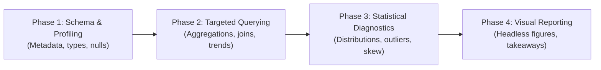

# Data Scientist Skill

High-throughput, memory-conscious data engineering, exploratory data analysis (EDA), statistical profiling, and publication-ready visualization.

Designed for analyzing large tabular datasets (CSV, Parquet, JSON/JSONL, Arrow, SQLite) locally without out-of-memory (OOM) crashes, sluggish pandas performance, or bloated intermediate states.

---

## 1. Core Stack & Philosophy

| Component | Role | Why It Was Chosen |
|---|---|---|
| **DuckDB** | Analytical SQL Engine | Zero-copy queries directly on Parquet/CSV files, vectorized execution, out-of-core streaming, native SQL syntax without ingestion overhead. |
| **Polars** | Columnar DataFrame Processing | Multi-threaded Rust core, lazy query plans (`LazyFrame`), predicate/projection pushdown, streaming engine for datasets larger than RAM. |
| **NumPy** | Numerical Kernels & Vector Math | High-performance array operations, linear algebra, vector distances, and fast statistical transforms. |
| **Matplotlib / Seaborn** | Visual Reporting & Artifacts | Scriptable, headless chart generation, saving to file (`.png`, `.svg`) with consistent typography, palette, and zero blocking UI calls. |

### Golden Rules & Memory Discipline

1. **Never load raw CSV/Parquet into pandas by default**: Pandas creates heavy Python object wrappers and consumes 5x–10x memory relative to disk file size.
2. **Favor Lazy Execution**: Always begin with `pl.scan_parquet()` or `pl.scan_csv()` rather than `.read_*()`. Apply projections (`select`) and predicates (`filter`) first, then `.collect(streaming=True)`.
3. **Use DuckDB for Fast Ad-Hoc SQL**: If the question can be answered with a `SELECT`, `GROUP BY`, `WINDOW`, or `JOIN`, run it directly against the file with DuckDB without loading the data into Python memory.
4. **Zero-Copy Interop**: Transfer zero-copy between DuckDB and Polars using Apache Arrow (`duckdb_conn.execute(...).arrow()` or `duckdb_conn.query(...).pl()`).
5. **Headless Plotting**: Always configure matplotlib for non-interactive backend (`matplotlib.use('Agg')`), save figures to disk, and explicitly call `plt.close(fig)` to avoid memory leaks.
6. **Execution Environment**: Execute all data processing scripts via `uv run python script.py`.

---

## 2. Standard 4-Phase EDA Workflow



### Phase 1: Schema & Summary Inspection
- **Row count & file sizing**: Inspect disk size and total rows without scanning full payloads.
- **Column schema & types**: Detect correct typing (e.g., categorical strings, timestamp formats, downcasted integers/floats).
- **Null ratios & unique cardinality**: Identify high-missingness columns and candidate primary/foreign keys.

### Phase 2: Targeted DuckDB / Polars Querying
- **Aggregations & Grouping**: Compute multi-dimensional metrics (e.g., revenue by segment, cohort retention, temporal patterns).
- **Window Functions**: Compute rolling averages, rankings, lead/lag period changes.
- **Filtering & Projections**: Push filter predicates as close to disk as possible.

### Phase 3: Statistical Distribution Analysis & Outlier Detection
- **Distribution metrics**: Mean, standard deviation, median, IQR (Interquartile Range), 1st/5th/95th/99th percentiles.
- **Skewness & heavy tails**: Flag skewed distributions where the mean is misleading.
- **Outlier detection**:
  - IQR rule: Values $< Q1 - 1.5 \times IQR$ or $> Q3 + 1.5 \times IQR$.
  - Z-Score / Modified Z-Score (MAD) for normal or near-normal series.
- **Correlation analysis**: Pearson/Spearman matrix for continuous features.

### Phase 4: Clean Visual Reporting
- **Non-interactive rendering**: Headless execution generating standalone `.png` / `.svg` in `./figures/` or `./output/`.
- **High-contrast, professional styling**: Clear axis labels, human-readable numbers (e.g. `$1.2M` instead of `1200000.0`), descriptive title, and source footnotes.
- **Actionable synthesis**: Pair every visualization with 2-3 bullet points detailing business or engineering implications.

---

## 3. Production Code Snippets

### A. Phase 1: DuckDB Instant File Profiling (CSV / Parquet)

```python
import duckdb

def inspect_dataset(file_path: str) -> None:
    conn = duckdb.connect()
    
    # 1. Total row count and column overview
    desc = conn.query(f"DESCRIBE SELECT * FROM '{file_path}'").df()
    print("=== Column Schema ===")
    print(desc[["column_name", "column_type", "null"]])

    # 2. Summary statistics across numeric & categorical fields
    print("\n=== Summary Stats ===")
    stats = conn.query(f"SUMMARIZE SELECT * FROM '{file_path}'").df()
    print(stats[["column_name", "min", "max", "approx_unique", "null_percentage"]])

if __name__ == "__main__":
    inspect_dataset("data/sample.parquet")
```

### B. Phase 2: Polars Lazy Streaming Aggregation

```python
import polars as pl

def analyze_large_dataset(parquet_pattern: str) -> pl.DataFrame:
    # Build lazy query plan with predicate and projection pushdown
    lazy_plan = (
        pl.scan_parquet(parquet_pattern)
        .filter(pl.col("status") == "COMPLETED")
        .select([
            pl.col("timestamp").dt.date().alias("date"),
            pl.col("category"),
            pl.col("amount"),
            pl.col("user_id"),
        ])
        .group_by(["date", "category"])
        .agg([
            pl.len().alias("transaction_count"),
            pl.col("amount").sum().alias("total_volume"),
            pl.col("amount").mean().alias("avg_volume"),
            pl.col("user_id").n_unique().alias("unique_users"),
        ])
        .sort(["date", "total_volume"], descending=[False, True])
    )
    
    # Stream chunks into memory, keeping peak RAM constrained
    result = lazy_plan.collect(streaming=True)
    return result

if __name__ == "__main__":
    df = analyze_large_dataset("data/*.parquet")
    print(df.head(20))
```

### C. Phase 3: Outlier Detection & Distribution Profiling

```python
import polars as pl
import numpy as np

def detect_outliers_iqr(df: pl.DataFrame, col_name: str) -> pl.DataFrame:
    # Compute quartiles
    q25 = df[col_name].quantile(0.25)
    q75 = df[col_name].quantile(0.75)
    iqr = q75 - q25
    lower_bound = q25 - 1.5 * iqr
    upper_bound = q75 + 1.5 * iqr

    print(f"[{col_name}] Q1: {q25:.2f}, Q3: {q75:.2f}, IQR: {iqr:.2f}")
    print(f"Bounds: [{lower_bound:.2f}, {upper_bound:.2f}]")

    outliers = df.filter(
        (pl.col(col_name) < lower_bound) | (pl.col(col_name) > upper_bound)
    )
    print(f"Detected {outliers.height} outliers ({(outliers.height / df.height * 100):.2f}% of data)")
    return outliers
```

### D. Phase 4: Headless, Publication-Grade Plotting

```python
from pathlib import Path
import matplotlib
matplotlib.use("Agg")  # Mandatory for headless environments
import matplotlib.pyplot as plt
import polars as pl

def export_eda_visualizations(df: pl.DataFrame, output_dir: Path) -> None:
    output_dir.mkdir(parents=True, exist_ok=True)
    
    # Example: Distribution and Trend Dashboard
    fig, axes = plt.subplots(1, 2, figsize=(14, 5), dpi=300)
    
    # Plot 1: Histogram / Boxplot
    axes[0].hist(df["amount"].to_numpy(), bins=50, color="#2563eb", edgecolor="white", alpha=0.85)
    axes[0].set_title("Transaction Amount Distribution", fontsize=12, fontweight="bold")
    axes[0].set_xlabel("Amount ($)")
    axes[0].set_ylabel("Frequency")
    axes[0].grid(True, linestyle="--", alpha=0.5)

    # Plot 2: Daily Volume Trend
    daily = df.group_by("date").agg(pl.col("amount").sum()).sort("date")
    axes[1].plot(daily["date"].to_numpy(), daily["amount"].to_numpy(), color="#059669", marker="o", linewidth=2)
    axes[1].set_title("Total Volume Over Time", fontsize=12, fontweight="bold")
    axes[1].set_xlabel("Date")
    axes[1].set_ylabel("Volume ($)")
    axes[1].grid(True, linestyle="--", alpha=0.5)
    fig.autofmt_xdate()

    plt.tight_layout()
    chart_path = output_dir / "eda_summary.png"
    plt.savefig(chart_path, bbox_inches="tight")
    plt.close(fig)
    print(f"Exported chart to {chart_path}")
```

---

## 4. Best Practices & Pitfalls Checklist

- [ ] **Never call `.to_pandas()` on full datasets**: If a library requires pandas, convert only aggregated or sampled subsets (`.sample(n=100_000)` or `.head()`).
- [ ] **Partitioning awareness**: When reading Parquet directories with Hive partitions (`year=2026/month=03/...`), allow DuckDB or Polars to prune partitions automatically via predicate pushdown.
- [ ] **Type casting**: Convert high-cardinality string columns to `pl.Categorical` or DuckDB `ENUM` when performing extensive joins or grouping to save up to 80% memory.
- [ ] **DuckDB memory limits**: When working on memory-constrained systems, configure DuckDB memory limits explicitly:
  ```python
  conn.execute("SET max_memory = '8GB';")
  conn.execute("SET preserve_insertion_order = false;")
  ```
- [ ] **No interactive GUI popup**: Never invoke `plt.show()` in automated scripts or agent runners; use `plt.savefig()` and `plt.close()`.
- [ ] **Reproducible scripts**: Structure scripts to take CLI arguments (`argparse` or `click`) so EDA pipelines can be rerun or automated.
